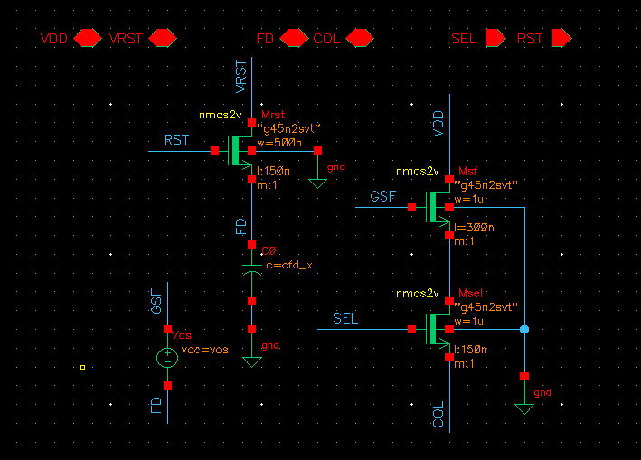
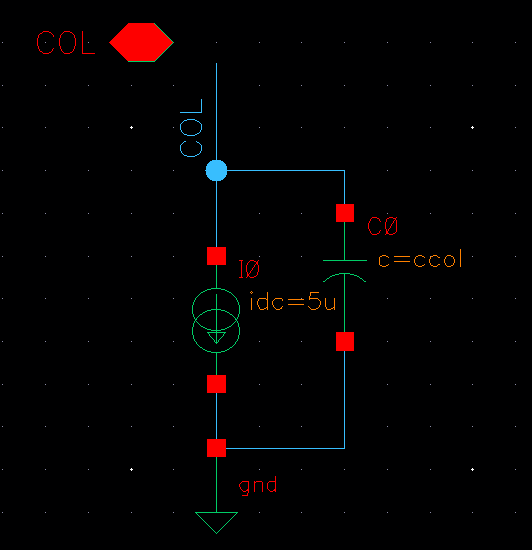
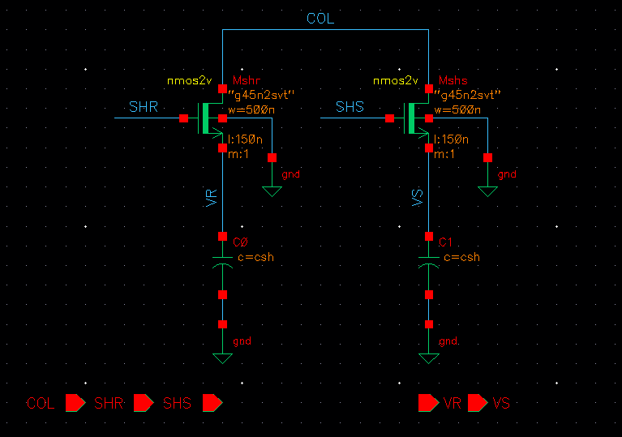
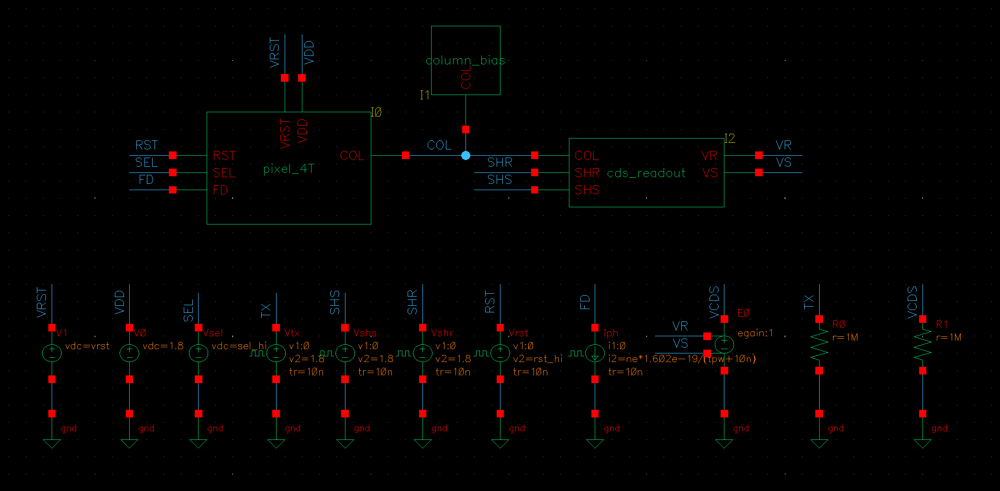
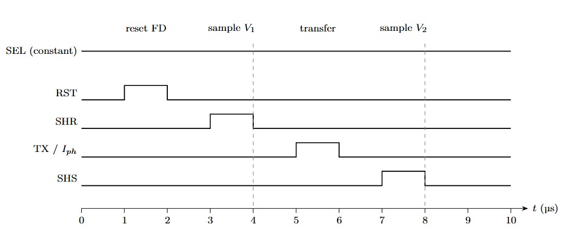
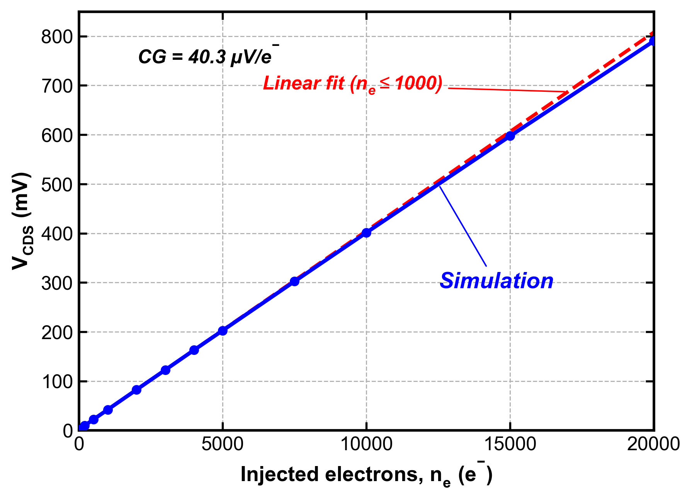
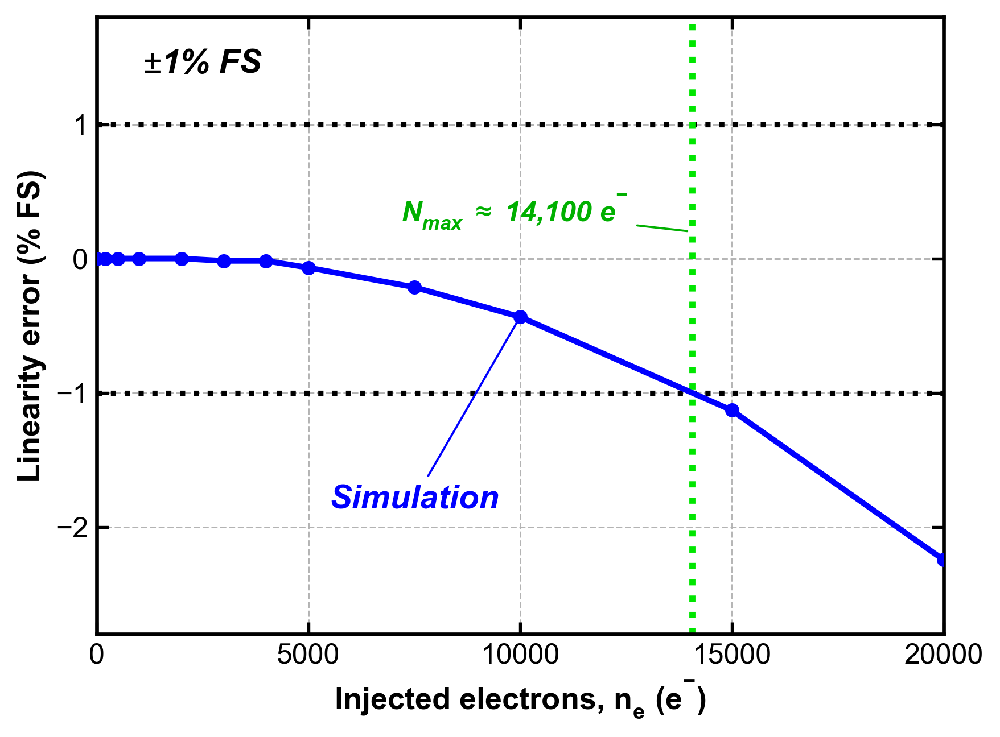
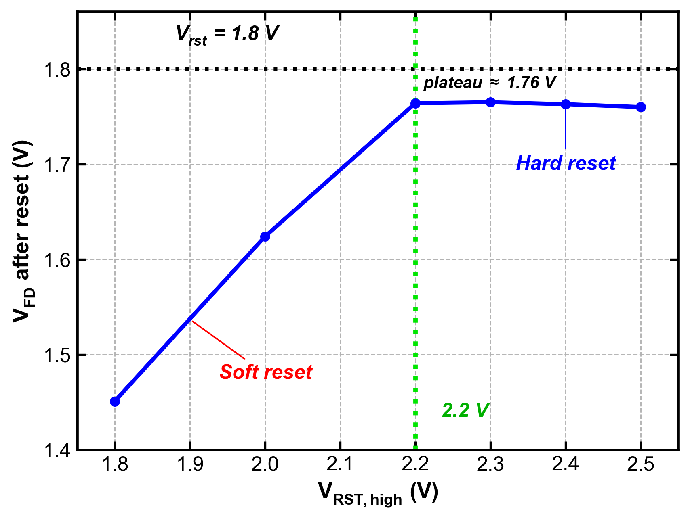

# 4T Pixel Readout with CDS in gpdk045: Conversion Gain, Linearity, and Offset Suppression

A schematic-level characterization study of a 4T CMOS image sensor pixel readout chain with correlated double sampling (CDS), built in Cadence Virtuoso and simulated with Spectre on the gpdk045 PDK (nmos2v, 1.8 V devices).

**Scope in one line:** this is a readout-chain study. The photodiode and transfer gate are replaced by an ideal charge-injection current source, the column bias is an ideal current source, and the subtractor is ideal. Noise analysis, dynamic range, and a real column current source are not done yet (see [Limitations](#limitations)).

## Results

| Metric | Result | Condition |
|---|---|---|
| Conversion gain (CDS output) | **40.3 µV/e⁻** | small-signal, linear fit for N_e ≤ 1000 |
| Effective FD capacitance | **3.57 fF** | q / slope of ΔV_FD vs N_e (hand calc: 3.554 fF) |
| Gain FD to output | 0.897 | hand calc: 0.894 |
| Linear range (1% error) | **~14,100 e⁻** | error vs. small-signal fit, normalized to full scale (V_CDS at N_e = 20,000), ideal column current source |
| SF offset suppression | **~1300×** | V_os swept ±30 mV: V_R shifts 53 mV, V_CDS shifts 40 µV (about 1 e⁻) |
| Hard reset | rst_hi ≥ 2.2 V | knee near 2.17 V |
| kT/C noise at FD | ~24 e⁻ (1.08 mV) | analytic, removed by CDS |
| kT/C noise at S&H | ~5.06 e⁻ (0.204 mV) | analytic, not removed by CDS, lower bound of read noise |

Hand calculations and simulation agree within 1% for C_FD,eff, conversion gain, and ΔV_FD.

## Circuit

| Block | Element | Size / value |
|---|---|---|
| Pixel | Mrst (nmos2v) | 0.5 / 0.15 µm |
| Pixel | Msf (nmos2v) | 1 / 0.3 µm |
| Pixel | Msel (nmos2v) | 1 / 0.15 µm |
| Pixel | Cfd | 3 fF (explicit) |
| Column | Bias current | 5 µA (ideal) |
| Column | Ccol | 100 fF |
| S&H | SHR, SHS switches | 0.5 / 0.15 µm, identical |
| S&H | Hold capacitors | 200 fF each |

Charge injection: Q = Iph · (PW + (tr + tf) / 2). With Iph = 0.5 nA, PW = 1 µs, tr = tf = 10 ns, Q = 0.505 fC, about 3150 e⁻. The sweep variable `ne` sets Iph = ne · q / (tpw + 10 ns).

## Timing

RST (1 to 2 µs), SHR (3 to 4 µs, V1 sampled on the falling edge), charge transfer (5 to 6 µs), SHS (7 to 8 µs, V2 sampled on the falling edge). SEL is held at a constant 2.5 V.

Read V_CDS after 8 µs. Between 3 and 7 µs, V_S still holds its initial operating-point value, so the V_CDS trace there is not a signal.

### Conversion gain and linearity (charge sweep)

`ne` swept from 0 to 20,000 with vos = 0. CG is the slope of V_CDS vs N_e, not V_CDS / N_e at a single point, because there is a small offset at N_e = 0 (1.74 mV). Gain compresses slightly at large signal (40.3 µV/e⁻ for N_e ≤ 2000, 38.5 µV/e⁻ for 15,000 to 20,000). The suspected causes are voltage-dependent C_FD and a small drop in SF gain; this was not isolated.

*Linearity error is measured against the small-signal fit (N_e ≤ 1000), normalized to V_CDS at N_e = 20,000. N_max is interpolated between only two points (10,000 and 15,000 e⁻), with an ideal column current source.*

The 14,100 e⁻ figure depends on the definition: error against the small-signal fit, normalized to V_CDS at the end of the sweep. A stricter definition (1% gain deviation from small-signal) gives a much lower number, roughly 4,000 to 7,500 e⁻ (coarse, 4-digit data).

### Offset suppression

A DC source `vos` in series with the gate of Msf stands in for pixel-to-pixel Vth variation. V_R and V_S shift with nearly identical slopes (0.882 and 0.883), so the offset appears in both samples and cancels in V_R − V_S.

*The V_CDS change of about 40 µV is near the resolution of the result table (4 digits, about 10 µV), so read it as roughly 1 e⁻, not as a precise number. The first plot shows measured differences for all three signals; V_CDS is data, not a reference line.*

This is a deterministic test (one offset per run), not a Monte Carlo FPN simulation.

### Reset

With an NMOS reset switch, FD follows rst_hi − Vth until the gate is high enough. At rst_hi = 1.8 V and 2.0 V the reset is soft (V_FD = 1.451 V and 1.624 V). From 2.2 V it is hard, with a plateau near 1.76 V. FD sits about 36 to 40 mV below vrst after reset; the suspected cause is clock feedthrough and charge injection from Mrst (hypothesis, not isolated).

*2.2 V is the first measured point that is already a hard reset. The 2.1 V point was not run, so the knee (about 2.17 V by estimate) lies somewhere between 2.0 and 2.2 V.*

## Debugging note: SEL was compressing the signal

The first sweep gave an effective gain of 0.66 to 0.74 and CG of 29.6 µV/e⁻, about 27% below the hand calculation, with gain that rose with signal. The cause was a design variable: `sel_hi` was 1.8 V At SEL = 1.8 V, Msel has only about 51 mV of overdrive, drops 55.7 mV, and passes only 0.51 of the signal from N1 to COL. At 2.5 V the drop is 5.36 mV and the gain is 0.994. After the fix, V_CDS / ΔV_FD = 0.898 and the Q sweep matches the hand calculation within 1%.

## Hand calculation vs. simulation

| Quantity | Hand calc | Simulation | Note |
|---|---|---|---|
| C_FD,eff | 3.554 fF | 3.57 fF (Q sweep), 3.54 fF (transient) | within 1% |
| ΔV_FD (N_e = 3150) | 142.1 mV | 142.6 mV | 0.4% |
| Gain FD to COL | 0.894 | 0.897 | 0.3% |
| CG (CDS output) | 40.3 µV/e⁻ | 40.3 µV/e⁻ | match |
| Msel drop | 5.88 mV | 5.36 mV (operating point) | |
| V_out of SF | 1.025 V | 1.105 V (operating point) | hand calc used the strong-inversion formula; Msf is in moderate inversion (Vov 54.5 mV, gm/Id 14.2) |
| N_max | 20,217 e⁻ (provisional) | ~14,100 e⁻ | different definitions; hand calc assumed a current-source Vdsat |

The hand-calculated gain matches the operating point partly by construction, because gm, gmbs, and gds come from the same operating point. The independent check is the V_CDS / ΔV_FD ratio from the transient.

## What CDS removes and what it does not

| Error source | Removed by CDS? | Basis |
|---|---|---|
| SF offset (Vth variation) | Yes | simulated: ~1300×, about 1 e⁻ for ±30 mV |
| kT/C of FD reset | Yes (ideal) | analytic: the reset happens once between the two samples |
| kT/C of S&H capacitors | No | analytic: occurs after the sampling instant, ~5 e⁻ |
| Photodiode dark current, kTC | not modeled | photodiode replaced by an ideal source |
| Mtx clock feedthrough | not modeled | Mtx is not in the model |

## Limitations

- Photodiode and Mtx are not modeled. Charge transfer is ideal. No image lag, dark current, or quantum efficiency.
- Column bias is an ideal current source, so the swing limit from the source leaving saturation is not visible. N_max may drop with a real NMOS source.
- Subtractor is ideal, no ADC.
- kT/C is analytic only.
- SF noise, CDS filtering of 1/f noise, and dynamic range are not analyzed. If you plug in the S&H-only read noise (5.06 e⁻), you get an upper bound of about 69 dB, and SF noise can only lower it.
- No Monte Carlo, corners, or temperature sweep.
- Single-cycle transient. The initial V_R and V_S values (about 0.2 V) are operating-point artifacts.
- S&H pedestal after the switches turn off is not measured.

## Next steps

1. SF noise analysis with the CDS filter, then dynamic range.
2. Verify kT/C with transient noise.
3. Monte Carlo for FPN, corners for process sensitivity.

## Reproducibility

Results were produced in Cadence Virtuoso and Spectre with the gpdk045 PDK, which is licensed and not included here. Netlists, raw simulation data, and PDK files are not part of this repository; the tables above are copied from the simulation result tables. Simulator setup: Spectre transient, 0 to 10 µs, errpreset moderate, reltol 1e-5, 27 °C.

## References

1. University of Oslo, IN5350 CMOS Image Sensor Design, Lecture 3: 3T/4T pixels and exposure control (2021).
2. gpdk045 PDK documentation.

